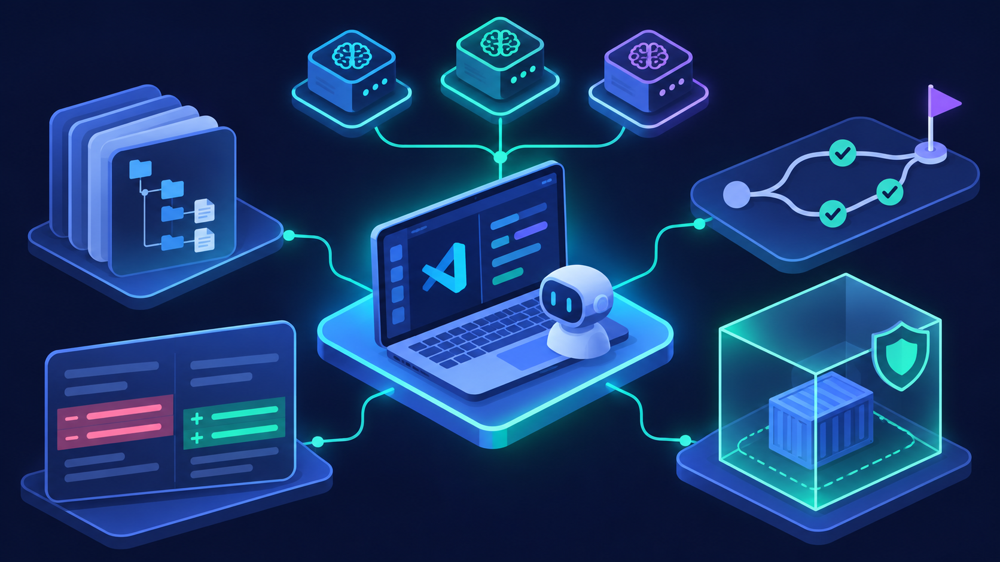

# HarnessX



**A local-first, open-source AI coding harness for VS Code.** HarnessX connects a chat model to repository context and a small set of reviewed coding tools. It can answer questions, build a file-grounded plan, propose edits, and run approved verification commands in a disposable Docker container. Ollama provides a fully local path with no paid API, cloud account, or subscription.

HarnessX is released under the [MIT License](LICENSE). The source, tests, and this original project illustration are in this repository. You can use, modify, and distribute the project under the license terms. Contributions are welcome; see [CONTRIBUTING.md](CONTRIBUTING.md).

> **Project status:** usable local development build. The core workflows have unit and live local-model tests. The extension host smoke test does not automate sidebar clicks or diff approvals, and remote compatible endpoints have not been exercised with a live account. See [Tests](#tests) and [Current limits](#current-limits) before relying on it for sensitive repositories.

## What it does

| Area | Current behavior |
| --- | --- |
| Models | Ollama chat and embeddings; OpenAI-compatible streaming chat and embeddings; Qwen through Ollama or a configured compatible endpoint. |
| Routing | Selects an available model using context fit, task complexity, capability, speed, preference, and estimated task cost; retries and falls back before partial output. |
| Modes | Ask streams an answer; Plan uses validated repository paths; Agent makes bounded, stepwise tool calls. |
| Repository tools | File listing, lexical and optional embedding search, read, reviewed complete-file edits, Git operations, tests, and rollback. |
| Safety | Diff approval for edits, command approval, protected paths, Docker copy for command execution, network isolation, resource limits, and execution logs in local sessions. |
| VS Code | Sidebar chat with mode and model selection, streaming, progress, session history, usage display, diff review, and rollback command. |

The architecture is modular: providers, routing, workspace tools, agent orchestration, sessions, Git, and sandbox execution live in `packages/core`; the VS Code interface lives in `apps/vscode-extension`.

## Requirements

- Node.js 22+, npm, VS Code 1.96+
- A running Ollama server with a chat model, or a configured OpenAI-compatible endpoint
- Docker Desktop or Docker Engine for Agent command execution and automatic verification
- The sandbox image `node:22-bookworm-slim` for Node projects (configurable for other stacks)

Docker is needed for Agent commands and automatic verification. Ask and Plan can run without Docker. The default Ollama configuration keeps prompts and source context on the local machine; configuring a remote model sends the context supplied to that provider to its endpoint.

## Install and run locally

```powershell
npm ci
npm test
code .
```

In VS Code, press **F5** to launch the Extension Development Host. Open a repository folder there and select the HarnessX icon in the Activity Bar. Select **Ask**, **Plan**, or **Agent**, then send a prompt. The initial build is required because the extension loads `apps/vscode-extension/dist/extension.js`.

For a free local chat model, start Ollama and pull a coder model, for example:

```powershell
ollama pull qwen2.5-coder:1.5b
ollama serve
```

If Ollama is already running, only the pull command is needed. Click the refresh button in the HarnessX sidebar to discover installed models. Larger models generally produce better tool choices but need more memory and time.

## Modes and approvals

- **Ask** streams a response using conversation history. It does not call workspace tools.
- **Plan** selects existing repository paths and builds a plan from those paths and observed search results. It does not change files or run commands.
- **Agent** asks the model for one JSON tool request per step. Available tools list and search files, read text, propose a complete-file edit, run a command, verify, inspect or change Git state, and roll back the latest edit.

File edits open a VS Code diff and require **Apply**. Commands run only after **Run** is selected. Git staging, commits, branch creation, and pushes also require approval. The model can make mistakes; inspect each diff and command. `HarnessX: Roll Back Last Edit` restores the latest edit while the extension host remains active, unless the file has changed since that edit.

After an approved edit, HarnessX attempts automatic verification using `npm test`, `python -m pytest`, or `cargo test` when a matching project manifest is present. Verification also requires command approval. The result appears in the agent answer. A rejected, unavailable, or failed test is reported; it is not treated as success.

## Models and settings

Open **Settings** and search for `HarnessX`, or add entries to workspace `settings.json`:

```json
{
  "harnessx.ollamaUrl": "http://127.0.0.1:11434",
  "harnessx.embeddingModel": "",
  "harnessx.maxUsdPerTask": 0,
  "harnessx.maxAgentSteps": 12,
  "harnessx.sandboxImage": "node:22-bookworm-slim",
  "harnessx.sandboxMemoryMb": 512,
  "harnessx.sandboxTimeoutMs": 60000,
  "harnessx.compatibleProviders": [
    {
      "id": "local-openai",
      "baseUrl": "http://127.0.0.1:1234/v1",
      "models": [{ "id": "qwen-local", "contextTokens": 8192, "maxOutputTokens": 1024, "speed": 4, "capability": 4 }]
    }
  ]
}
```

An OpenAI-compatible endpoint may be local or remote. For a remote Qwen API, set `baseUrl` to its compatible-mode `/v1` URL, add the model ID, set `apiKeyEnv` to the **name** of an environment variable holding the key, and provide `inputCostPerMillion` and `outputCostPerMillion`. Remote models without explicit prices are excluded from automatic routing. Never put a key directly in settings or Git. The extension reads environment variables from the VS Code extension host process.

The router considers model availability, estimated context fit, capability, speed, a preferred model, and estimated per-task cost. It retries transient failures and tries another eligible model when a request fails before streaming. Reported provider token usage drives the dashboard; when unavailable, HarnessX estimates tokens from text length. Budgets are estimates, especially for endpoints that do not return usage.

For semantic search, pull an Ollama embedding model such as `all-minilm` and set `harnessx.embeddingModel` to its name. HarnessX embeds bounded code chunks and caches vectors in memory during the session. Without an embedding model, search uses lexical line matching. Search excludes common credential files, dependency folders, and build artifacts. Ollama embedding-only models are excluded from chat routing.

## Sandbox and data boundaries

The command runner copies the workspace into a temporary folder, excludes `.git`, common secrets, and build artifacts, and runs the command in Docker with network disabled, a read-only container filesystem, dropped capabilities, a process limit, CPU and memory limits, and a timeout. Commands can modify only the temporary copy. Git tools are separate: their mutating operations run in the host repository after individual approval. Agent file edits are applied to the host workspace only after diff approval.

Sessions and edit backups are stored under VS Code global storage, partitioned by workspace path. They include prompts, responses, tool outputs, usage, action logs, and prior file text. They are local files and may contain repository content. Protected paths such as `.env`, private keys, and `.git` are blocked from model file tools. Review repository content before sending it to a remote model.

## Architecture

- `packages/core/src/providers.ts`: Ollama and OpenAI-compatible streaming chat and embeddings
- `packages/core/src/routing.ts`: context estimation, compaction, and budget-aware model ranking
- `packages/core/src/agent.ts`: Ask, Plan, and multi-step Agent orchestration
- `packages/core/src/workspace.ts`: confined file access, lexical and embedding search, edits, rollback
- `packages/core/src/sandbox.ts`: approved Docker command execution on a disposable copy
- `packages/core/src/git.ts`: constrained Git operations with approval for mutations
- `packages/core/src/sessions.ts`: atomic local session persistence
- `apps/vscode-extension`: sidebar UI, diff review, settings, and extension host integration

## Tests

```powershell
npm test
$env:HARNESSX_TEST_DOCKER = '1'
node --test packages/core/dist/sandbox.test.js
Remove-Item Env:HARNESSX_TEST_DOCKER
npm run test:extension
npm run test:live
```

The normal suite covers routing, provider streaming protocols, workspace safety, semantic ranking, session persistence, agent orchestration, and Git approvals. The Docker test needs a running engine and the configured image. It confirms that rejected commands do not run, secrets are excluded, and writes do not reach the original workspace. The extension test downloads an isolated VS Code build and checks extension activation and commands. The live test needs Ollama, a chat model, and Docker; it uses a disposable project and approves only its known test edit and `npm test` command.

## Troubleshooting

- **No model available:** check `http://127.0.0.1:11434/api/tags`, pull a model, and refresh the sidebar. For a compatible endpoint, verify its URL and model ID.
- **No available model fits the budget:** increase the task budget or select a local free model. Add explicit prices for remote models.
- **Docker unavailable:** start Docker Desktop or Docker Engine. Ask and Plan continue to work; Agent commands and verification require Docker.
- **Sandbox test cannot find dependencies:** run `npm ci` on the host first. The sandbox copies installed dependencies but disables network access.
- **Slow local generation:** use a smaller model, reduce agent steps, or increase Docker and Ollama resources independently.
- **A command or edit was rejected:** rerun the task with a narrower request; HarnessX will not bypass the approval.

## Current limits

The agent uses a JSON tool protocol, so model quality strongly affects autonomous completion. Semantic search is bounded to 120 code chunks per query. Rollback backups survive an extension host restart, but there is no history browser or retention policy yet. The extension host test checks activation and commands; it does not automate webview clicks or diff approval. Small local models can make incorrect plans or tool choices. There is no claim of security isolation against a compromised Docker daemon. HarnessX is not independently security audited or published to the VS Code Marketplace.

## Contributing and support

This project is developed in the open at [Irish-Joseph/HarnessX](https://github.com/Irish-Joseph/HarnessX). Issues are useful for reproducible bugs, model compatibility reports, documentation gaps, and focused feature proposals. Before opening a pull request, read [CONTRIBUTING.md](CONTRIBUTING.md), run the relevant tests, and describe what was verified. Do not commit credentials, local session stores, model files, or generated build artifacts.

The most useful areas for contributions are automated sidebar interaction tests, real compatible-provider interoperability checks, broader sandbox images for non-Node repositories, and bounded session-history management. Features listed here as limits are not represented as already working.

## License and artwork

HarnessX source code, documentation, and the original README illustration are provided under the [MIT License](LICENSE). Keep the copyright and license notice when redistributing substantial portions. The repository may use third-party tools and models, including VS Code, Docker, Ollama, and Qwen; their own licenses and terms apply separately. The illustration is project artwork, not a screenshot of a running extension.
